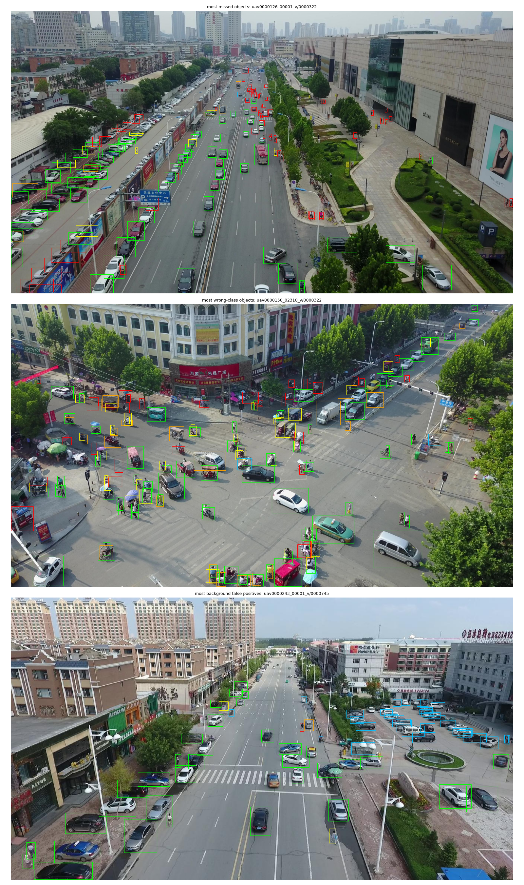

## Introduction

We detect 8 object classes (person, bicycle, car, van, truck, tricycle, bus, motor) in drone video frames from VisDrone2019-VID and submit boxes for 48 unlabelled test clips. The labelled data has 56 train clips and 7 val clips with 1.2 million objects.

The data analysis showed four main difficulties:

- 24% of objects are smaller than 32х32 px, so the input resolution decides how many objects are visible.
- 42 objects per frame at the median.
- Сar and person are three quarters of the objects, bus is under 1%.
- Neighbouring frames are near-duplicates, clips come from shared source flights (why it matters - possible data-leakage if split unwisely).

We compare four detector families under one protocol and OOF validation, next to a YOLO11s baseline, and then build the final pipeline from data, inference and ensemble strategies on top of the best models.

## Method

### Data preparation

Code: [01_eda_preprocessing.ipynb](notebooks/01_eda_preprocessing.ipynb).

Test frames are 680–1920 px wide, while labelled frames start at 1344 px.

The annotations are clean: no zero-size or oof boxes, no duplicates, no gaps in frame numbering.

Findings and decisions:
- at minimum of 640 px, 9.7% of objects are below 8 px (finest feature map) while at 1280 px only 0.6% do $->$ all models are trained and evaluated at 1280 px.

- k-means on box sizes at 1280 px gives shapes from 9х16 to 124х99 px with aspect ratios 0.5–1.9 $->$ test anchors of 16–256 px.

- dense scenes  $->$ keep up to 500 detections per image and use 300 queries for RT-DETR.

- Neighbouring frames are near-duplicates  $->$ train on every 5th frame (five times less compute and frames differ) 

- A frame has ~20 ignored regions and others, and 72% of frames have at least one. In training we fill them with the frame's mean colour and drop objects at least 50% inside them (all models except the baseline) ( crowds are neither learned as background nor counted as misses). YOLO txt and COCO json labels agree exactly on 60 checked val frames

- Eight test clips are only 680–960 px wide, and test frames are darker (mean brightness 100 vs 116)  $->$ check every inference variant on frames shrunk to 960 px as well.

### Validation

 The official val has only 7 clips (bus is in one of them), so we pool train and val (63 clips, 55 flights) and split them into 4 folds with GroupKFold by flight, so no flight is in both train and held-out. Models are compared by oof mAP of the last epoch. Anchors are fitted on training folds only. Test predictions of the 4 fold models are merged with WBF.

### Protocol and tuning

One protocol for all detectors ([PROTOCOL](src/core/__init__.py)): COCO weights, 1280 px, every 5th frame, flip, ignored-region masking, 8 epochs, batch 4. Each family changes one parameter at a time on fold 0, and the best experiment gets the full 4-fold CV.

## Results

### Baseline

YOLO11s, Ultralytics defaults, 20 epochs, no masking ([02](notebooks/02_baseline.ipynb)). OOF mAP 0.188, AP50 0.356, AP_small 0.053, 35.6 ms. Fold mAP ranges 0.156-0.247 with the held-out flights, so one split could not separate most variants. Public LB: 0.173 for one fold model, 0.213 for the 4-fold ensemble.

### Two-stage: Faster R-CNN

SGD, lr 0.005, warmup + cosine ([03](notebooks/03_faster_rcnn.ipynb)). All experiments are within 0.010 of the default (0.225 on fold 0); step LR is best (0.235). OOF mAP 0.212, AP50 0.416, AP_small 0.055, 66 ms: +0.024 over the baseline.

The RPN sets the recall ceiling: 1,000 proposals cover 39% of objects under 16 px and 74% of 16–32 px ones. The RoI head keeps 92% of covered objects but does not tighten tiny boxes. 

Failure cases: tiny distant objects and tightly parked cars get no proposal; tricycle, motor and bicycle are confused from above; unlabelled parked cars count as false positives.

### One-stage anchor-based: RetinaNet

[04](notebooks/04_retinanet.ipynb). With 32–512 anchors no anchor matches an object under 16 px; anchors 16–256 leave 47% unmatched but double the negatives per positive (286 $->$ 580). They raise AP_small (0.025 $->$ 0.042) but lose 0.07 AP_large, so mAP falls (0.215 $->$ 0.199); lower IoU thresholds are worse. γ = 0 is best (0.221). OOF mAP 0.188, AP_small 0.041, 49 ms: equal to the baseline, 0.024 below Faster R-CNN.

Without a proposal stage localisation is weaker (AP75 0.176 vs 0.190) and small objects suffer most (AP_small 0.041 vs 0.055). Focal loss turned out unnecessary: the classifier's prior bias already handles the imbalance. Better positive assignment (ATSS) addresses this more directly than anchor sizes.

### Anchor-free: FCOS

[05](notebooks/05_fcos.ipynb). A location is positive for an object if it lies inside the box, within radius х stride of its centre, on the FPN level matching the box size; overlaps go to the smallest box. At radius 1.5 a 16–32 px object gets 6 positives, at 2.5 it gets 9; 4.7% of objects under 16 px get none, being smaller than the stride. In crowds a wider radius makes neighbours' regions overlap.

Search: radius 0.5 / 1.5 / 2.5, box loss х2. Nothing beats the default (0.205): radius 0.5 gives too few positives, 2.5 loses AP_medium in crowds. OOF mAP 0.179, AP_small 0.050, 49 ms. FCOS beats RetinaNet on small objects (0.050 vs 0.041) but loses on medium and large ones; Faster R-CNN leads in every size bin.

### Query-based: RT-DETR

RT-DETR-L, AdamW, cosine, 300 queries, the baseline's budget of 1.5 GPU-h per fold ([06](notebooks/06_rtdetr.ipynb)). Hungarian matching assigns each object to exactly one query and trains the rest as "no object", so duplicates are not produced and NMS is not needed. Early in training the matching is unstable, which slows convergence; denoising queries stabilise it.

With the default lr of 10⁻⁴ the model has not converged in 1.5 h (0.096 on fold 0); lr 3·10⁻⁴ nearly doubles it (0.173), and without denoising mAP is the same (0.175) with higher AP_small, so this version is selected. YOLO11s is still higher under this budget (0.195), but RT-DETR has the highest recall (AR500 0.43 vs 0.31) and is much stronger on frames with more than 100 objects (0.27 vs 0.17). The fold-2 CV run failed (0.0005), so we report the mean of the other folds, 0.168. An earlier single RT-DETR-L run scored 0.307 on the public LB, the best single model before the pipeline.

### Comparison

| Model | Initial (fold 0) | Selected | OOF mAP | AP50 | AP_small | ms | Public LB |
|---|---:|---|---:|---:|---:|---:|---:|
| YOLO11s baseline | 0.195 | — | 0.188 | 0.356 | 0.053 | 36 | 0.213 |
| Faster R-CNN | 0.225 | step LR | 0.212 | 0.416 | 0.055 | 66 | 0.243 |
| RetinaNet | 0.215 | γ = 0 | 0.187 | 0.357 | 0.041 | 49 | 0.188 |
| FCOS | 0.205 | default | 0.179 | 0.355 | 0.050 | 49 | 0.162 |
| RT-DETR-L | 0.096 | no denoising | 0.168* | 0.317* | 0.043* | 196 | 0.307† |

\* mean of 3 folds, not OOF. † an earlier single-model run, not the fold ensemble of 06.

### Final pipeline

The pipeline is built on RT-DETR, the best model on the LB. Every step is chosen on the official val (~570 frames, unseen by these models) and kept only if it beats the previous one at native resolution, at 960 px and in most clips.

1. Test-time views ([07_pipeline_variants_old](experiments/07_pipeline_variants_old.ipynb)): flip and 2х2 tiles merged by NMS raise RT-DETR from 0.264 to 0.287 (7 of 7 clips; AP_small 0.118 $->$ 0.177; at 960 px 0.255 $->$ 0.265).
2. Merging and temporal rescoring ([07_1_temporal_old](experiments/07_1_temporal_old.ipynb)): WBF over the same views drops to 0.258, since an object seen in one tile gets its score averaged with views that missed it. Temporal rescoring ([rescore](src/core/temporal.py)) lowers boxes not confirmed in neighbouring frames: +0.003 at best, but better in only 3 of 7 clips, so it is not used. LB 0.314.
3. Ensemble ([07_2_ensemble_old](experiments/07_2_ensemble_old.ipynb)): Faster R-CNN with the same views (0.228) fused with RT-DETR by WBF, weights 3:1, IoU 0.7; here WBF fits because both models see the same views. Val 0.292 (0.275 at 960 px, 7 of 7 clips), LB 0.322.
4. RT-DETR trained on tiles ([07_1_rtdetr_tiles](notebooks/07_1_rtdetr_tiles.ipynb)), following SAHI: every training frame is used whole and as 2х2 tiles cut at full resolution (15,250 images, 5.5 GPU-h). Its views are chosen by the same rule:

| Variant (val) | Views | mAP | AP_small | mAP @960 | clips better | ms |
|---|---|---:|---:|---:|---:|---:|
| full | full 1280 | 0.255 | 0.105 | 0.246 | — | 121 |
| flip_wbf | + flip | 0.256 | 0.103 | 0.251 | 7/7 | 260 |
| scale_wbf | + 1600 px | 0.260 | 0.106 | 0.254 | 5/7 | 293 |
| tiles_nms | + tiles, NMS | 0.272 | 0.140 | 0.263 | 7/7 | 484 |
| tiles_wbf | + tiles, WBF | 0.254 | 0.142 | 0.250 | 6/7 | 484 |
| all_nms | all, NMS | 0.274 | 0.143 | 0.265 | 7/7 | 795 |
| all_wbf | all, WBF | 0.264 | 0.137 | 0.262 | 6/7 | 795 |

Tile views again add about +0.02 and NMS again beats WBF. The model trained on tiles is lower on val than the one trained on full frames (0.274 vs 0.287), but it is the best on the public LB (0.329 vs 0.322). Val has 7 clips from a few flights, while test has 48 darker and smaller clips, so val cannot separate differences of 0.01. Training on tiles shows small objects at native size, which should help most on low-resolution test clips, and the LB agrees; we follow the LB here, knowing val does not confirm it.

5. Second model on all flights ([07_2_rtdetr_final](notebooks/07_2_rtdetr_final.ipynb)): the same recipe trained on train + val (63 clips, 17,045 images, 10 epochs in 4.5 h on 2хT4) with another seed and the views of step 4. Since all labelled clips are used, there is no internal score and the LB is the only check. Alone it scores 0.269, well below step 4, but its boxes merged with those of step 4 by class-wise NMS (IoU 0.65) give 0.334, our best submission. The two models make different mistakes, so the merge adds boxes that one of them missed.

Unsuccessful attempts: RetinaNet with smaller anchors or lower IoU thresholds; all FCOS changes; RT-DETR at lr 10⁻⁴; WBF over test-time views (0.258 vs 0.287); temporal rescoring (+0.003 but better in only 3 of 7 clips; on the tile-trained model it lowers mAP from 0.274 to 0.265 or less); YOLO11m with the same views (0.253, below RT-DETR); fusion IoU 0.8 in the ensemble (0.288 vs 0.292); the train + val model alone (LB 0.269).

### Bonus: visualization

[08_visualization](notebooks/08_visualization.ipynb); training curves, configs and held-out predictions of every run are in [W&B](https://wandb.ai/hamaniuk-pn-ucu/visdrone-vid-hw2). Grad-CAM on Faster R-CNN: almost every box is pooled from P2, and small objects are explained only by the stride-4 maps (C4–C5 are close to uniform). t-SNE of RoI features: wrong-class detections gather where the bicycle–motor–tricycle and car–van clusters touch, and detections in ignored regions look like real people and cars. RT-DETR attention: the decoder samples around the box in the first layers, on the object in the middle ones and on context in the last ones, more for small objects and in dense scenes.

## Final model and reproducibility

Final model: two RT-DETR-L models trained on full frames and full-resolution tiles, one on train (step 4) and one on train + val (step 5). Each predicts the full frame at 1280 px, its flip, 1600 px and 2х2 tiles; all boxes are merged by class-wise NMS (IoU 0.65), ≤500 per image. Public LB 0.334. The first model alone scores 0.274 on val and 0.329 on the LB; the second has no internal score. <!-- [FILL] private LB when published -->

Run: every notebook runs on Kaggle (T4, Internet on, competition data attached), clones this repository and installs Ultralytics and faster-coco-eval ([requirements.txt](requirements.txt)), seed 42. Order: 01 $->$ 02 $->$ 03–06 $->$ 07_1 $->$ 07_2, with earlier outputs attached as inputs. The earlier pipeline steps in [experiments/](experiments/) (*_old) ran on commit 046347a (package src/vod). The final submission: run [07_1_rtdetr_tiles](notebooks/07_1_rtdetr_tiles.ipynb) (T4 х2, ~7 h), then [07_2_rtdetr_final](notebooks/07_2_rtdetr_final.ipynb) with its output attached (T4 х2, ~6.5 h), which writes submission_r1_r2.csv. Each run saves cv_<name>.json with config, seed and versions.

## Conclusion

Under one protocol Faster R-CNN is the strongest family (OOF 0.212), RetinaNet matches the baseline and FCOS is the weakest. RT-DETR does not converge in 1.5 h, yet it is the best single model on the LB and the strongest in dense scenes. Small objects limit every model, and tiles helped more than any architecture or loss change. NMS suits views that see different objects, WBF views of the same objects. Fold scores differ by up to 0.09 between flights, so small differences are not reliable.

AI usage: AI (Claude) helped write and debug code, fix grammar; experiment choices, interpretation and text are ours.

## References

[VisDrone](https://arxiv.org/abs/2001.06303) ·
[Faster R-CNN](https://arxiv.org/abs/1506.01497) ·
[FPN](https://arxiv.org/abs/1612.03144) ·
[RetinaNet](https://arxiv.org/abs/1708.02002) ·
[YOLOv2](https://arxiv.org/abs/1612.08242) ·
[FCOS](https://arxiv.org/abs/1904.01355) ·
[ATSS](https://arxiv.org/abs/1912.02424) ·
[DETR](https://arxiv.org/abs/2005.12872) ·
[DN-DETR](https://arxiv.org/abs/2203.01305) ·
[RT-DETR](https://arxiv.org/abs/2304.08069) ·
[Ultralytics](https://docs.ultralytics.com) ·
[GroupKFold](https://scikit-learn.org/stable/modules/generated/sklearn.model_selection.GroupKFold.html) ·
[COCO metrics](https://cocodataset.org/#detection-eval) ·
[faster-coco-eval](https://github.com/MiXaiLL76/faster_coco_eval) ·
[TIDE](https://arxiv.org/abs/2008.08115) ·
[SAHI](https://arxiv.org/abs/2202.06934) ·
[WBF](https://arxiv.org/abs/1910.13302) ·
[Soft-NMS](https://arxiv.org/abs/1704.04503) ·
[Seq-NMS](https://arxiv.org/abs/1602.08465) ·
[T-CNN](https://arxiv.org/abs/1604.02532) ·
[Grad-CAM](https://arxiv.org/abs/1610.02391) ·
[Deformable DETR](https://arxiv.org/abs/2010.04159) ·
[t-SNE](https://www.jmlr.org/papers/v9/vandermaaten08a.html)
