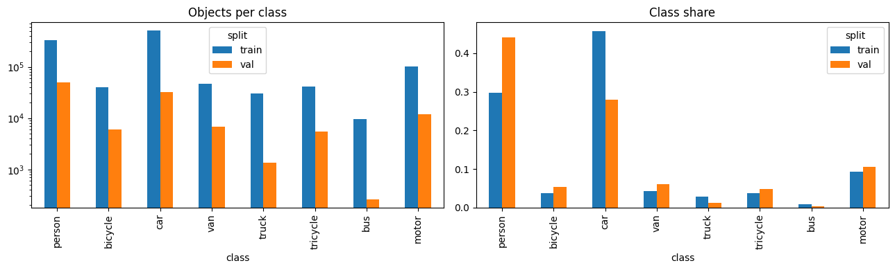
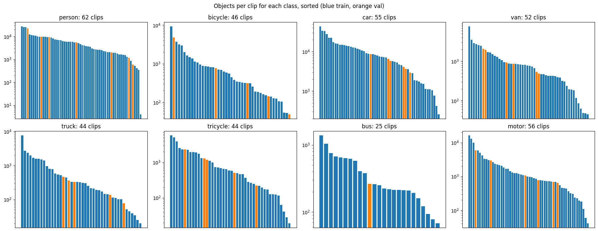
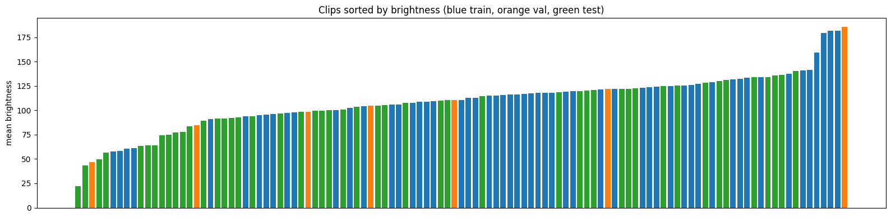
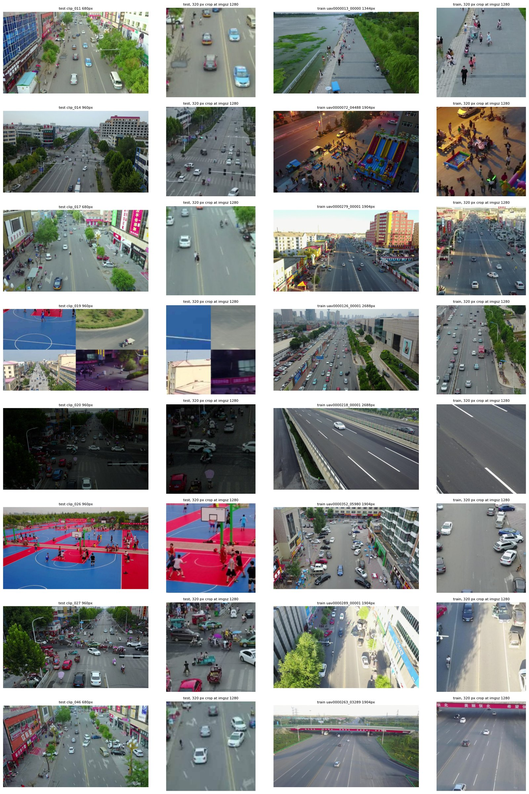
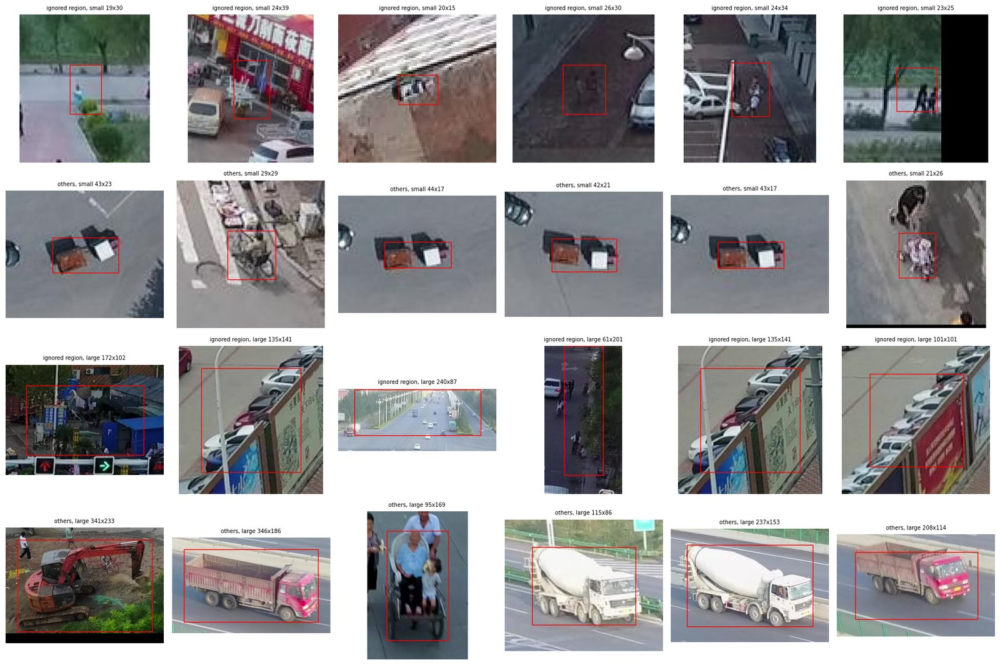
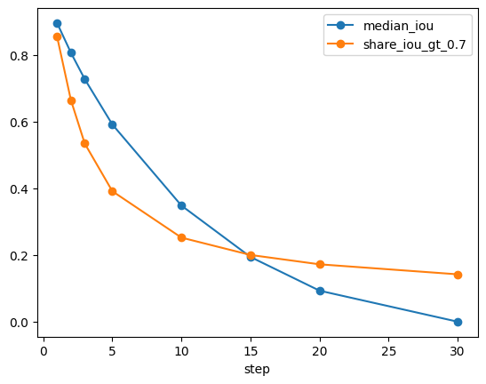
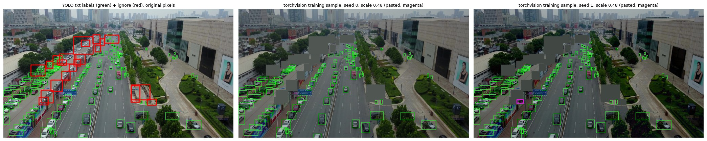

## Introduction

_TODO_

## Method

### Data

Code: `notebooks/01_eda.ipynb`.

| | train | val | test |
|---|---|---|---|
| clips / frames | 56 / 24,201 | 7 / 2,846 | 48 / 3,811 |
| objects (per frame) | 1,105,516 (45.7) | 114,132 (40.1) | — |
| ignored annotations | 510,744 | 31,960 | — |
| frame widths, px | 1344–2720 | 1344–3840 | 680–1920 |
| mean brightness (0–255) | 116 | 108 | 100 |

Data: No missing values, no zero-size, OOF boxes, duplicates, gaps in frame numbering, and the jpg count matches its annotations. 352 boxes have an aspect ratio above 6:1; they are objects cut by the frame border, so we keep them. 3 train frames have no objects.

Classes: Car and person dominate train; bus is 0.9% of objects. mAP averages over classes, so bus counts as much as car. Val has a different mix because it is only 7 clips. We do not rebalance val. Bus appears in 25 of 63 clips and in only one val clip, so val AP for bus is unreliable.

**Object sizes → input resolution and anchors.** By COCO area, 24% of objects are small, 64% medium, 12% large; person is 37% small, bus 57% large. The share of objects that shrink below 8 px (one cell of the finest stride) depends on the input size:

| imgsz | 640 | 1024 | 1280 | 1536 |
|---|---|---|---|---|
| objects below 8 px at network input | 9.7% | 1.4% | 0.6% | 0.2% |

We train at 1280: 640 loses about a tenth of the objects, and 1536 gains little for its cost. k-means on box shapes at 1280 gives clusters from 9×16 to 124×99 px with h/w between 0.5 and 1.9 (person ≈ 2.0, car ≈ 0.8). This sets the anchor sizes (16–256) and aspect ratios used for the anchor-based models.

**Scene density.** Frames hold 42 objects at the median and 180 at most; 7.5% have more than 100. The per-clip median ranges from 5 to 150. We keep up to 500 detections per image and need at least 300 queries for query-based models.

**Test differs from train.** Eight test clips are 680–960 px wide, smaller than any train clip (≥1344 px). Upscaled to 1280, they are much blurrier: the median Laplacian variance at network input is 84–215 for test versus 497–848 for train. Test is also darker (mean brightness 100 vs 116; share of dark pixels 0.20 vs 0.11), and its darkest clip has a mean of 22. One test clip is a 2×2 collage of four videos. This motivates the downscale/JPEG and brightness augmentations that we test in the final pipeline.

**Ignored regions and non-target classes.** Train has 498,952 ignored regions (crowds, parking lots, distant people) and 11,792 "others" (mixers, excavators, carts), about 20 per frame. Their median side is 94 px versus 46 px for objects. 72% of frames contain them, and in 2,536 frames they cover more than half of the image. 2.7% of target objects lie at least half inside one. Val has only 8 "others".

**Temporal redundancy → frame step.** The median IoU of the same track between frames t and t+k is 0.90 (k=1), 0.73 (k=3), 0.59 (k=5) and 0.35 (k=10). Neighbouring frames are near-duplicates, so we train on every 5th frame (4,868 frames). That saves 5× GPU time while consecutive training frames still differ noticeably.

### Preprocessing and validation

Ultralytics models read the provided YOLO labels. For torchvision, `vod.data.load_split` converts the COCO json to pixel `xyxy` boxes with labels 1–8 (0 is background) and keeps the ignored regions separately. On 60 val frames, the YOLO and COCO labels agree exactly: same box counts, no class mismatches, 0 px difference. The figures above and below confirm the boxes visually.

During training, ignored regions and others are filled with the frame's mean colour, and target boxes that are at least 50% covered are dropped, so the model is neither taught that crowds are background nor asked to find objects on a grey patch. 

Clip names show that several clips are segments of one source video. The provided val (7 clips, no source video shared with train) is the fixed hold-out for comparing detectors. For the final pipeline, we use 5-fold GroupKFold grouped by source video (11 sources and ~5,400 frames per fold), so no video is split across folds. Test clip names are anonymised, so overlap with train cannot be checked.

Frames are resized so that the long side is 1280, and boxes are scaled with them. All detector comparisons share one protocol (`src/vod/protocol.py`): every 5th train frame, horizontal flip (p=0.5), masking of ignored regions, 8 epochs, seed 42. Extra augmentations are kept out of the comparison and tested only in the final pipeline:

| augmentation | reason (from the data) |
|---|---|
| brightness/contrast jitter, p=0.5 | test is darker than train |
| downscale ×0.35–0.75 + JPEG q30–75, p=0.3 | low-resolution, blurry test clips |
| copy-paste of clean bicycle/van/truck/tricycle/bus objects, p=0.5 | rare classes; the object bank is built from **train only** (964 buses) |
| repeat-factor sampling, t=0.5 | rare classes; weak here: bus frames rise only from 27% to 34%, because bus frames are common while bus objects are not |

Evaluation COCO mAP, AP50 and AP_small (faster-coco-eval) on every val frame, with up to 500 detections per image and ignored regions skipped.

### Two-stage anchor-based

_TODO_

### One-stage anchor-based

_TODO_

### One-stage anchor-free

_TODO_

### Query-based

_TODO_

### Final pipeline

_TODO_

### How to run

_TODO_

## Results

### Cross-validated baseline

YOLO11s, Ultralytics defaults, 20 epochs, 1280 px, every 5th training frame, no ignore masking; last epoch per fold. Train + val pooled, 4 folds grouped by source flight, every frame of the held-out fold evaluated. Code: `notebooks/02_baseline.ipynb`; numbers: `reports/baseline/cv_baseline.json` (Tesla T4, ultralytics 8.4.207, torch 2.11.0, seed 42).

| | mAP | AP50 | AP75 | AP_small | AP_medium | AP_large | ms / image |
|---|---|---|---|---|---|---|---|
| fold 0 | 0.195 | 0.367 | 0.179 | 0.039 | 0.148 | 0.337 | 35.6 |
| fold 1 | 0.247 | 0.450 | 0.236 | 0.067 | 0.254 | 0.429 | 35.5 |
| fold 2 | 0.156 | 0.321 | 0.131 | 0.050 | 0.167 | 0.313 | 35.7 |
| fold 3 | 0.203 | 0.363 | 0.199 | 0.069 | 0.178 | 0.362 | 35.8 |
| mean ± std | 0.200 ± 0.038 | 0.375 ± 0.054 | | 0.056 ± 0.014 | | | 35.6 |
| **OOF (all 27,047 frames)** | **0.188** | **0.356** | **0.173** | **0.053** | **0.175** | **0.334** | |

OOF AP per class: car 0.452, bus 0.281, person 0.201, tricycle 0.186, van 0.135, motor 0.123, bicycle 0.062, truck 0.060.

Speed is Ultralytics' preprocess + inference + NMS per image, in chunks of 8, after one warm-up pass. Training took 1.5 h per fold on a T4 (Ultralytics defaults from `reports/baseline/fold*/args.yaml`: SGD-auto, lr0 0.01, AMP, mosaic with `close_mosaic` 10, scale 0.5, translate 0.1, horizontal flip 0.5).

On the per-epoch curve (every 10th held-out frame), the best epoch scores 0.011–0.026 mAP above the last one in every fold. Keeping Ultralytics' `best.pt` would have chosen the epoch on the held-out fold and inflated the OOF score by about that much, so we keep the last epoch.

The fold mAP ranges from 0.156 to 0.247 depending on which flights are held out, larger than most differences between the detector variants in the holdout table below, so single-split comparisons are not reliable. Small objects are the main weakness (AP_small 0.053 vs AP_large 0.334), and truck and bicycle score lowest: truck AP varies from 0.017 to 0.183 across folds, so its few clips dominate.

### Fixed train/val holdout (earlier protocol)

The table below uses the provided val split (7 clips) and is not comparable with the cross-validated numbers above.

| Model | mAP | AP50 | AP_small | ms / image | Public LB |
|---|---|---|---|---|---|
| YOLO11s baseline (Ultralytics defaults, 20 epochs, no ignore masking) | 0.204 | 0.397 | 0.101 | 26.8 | 0.233 |
| Faster R-CNN, default (protocol) | 0.208 | 0.424 | 0.108 | 62.7 | 0.224 |
| Faster R-CNN, RoI positive fraction 0.5 | 0.198 | 0.405 | 0.083 | 65.1 | — |
| Faster R-CNN, RPN anchors 16–256 | 0.206 | 0.437 | 0.100 | 64.6 | — |
| Faster R-CNN, box regression loss ×2 | 0.208 | 0.422 | 0.096 | 64.5 | — |
| RetinaNet, default anchors (protocol) | 0.180 | 0.346 | 0.063 | 52.5 | — |
| RetinaNet, anchors 16–256 | 0.164 | 0.359 | 0.072 | 55.1 | — |
| RetinaNet, anchors 16–256 + IoU 0.4/0.3 | 0.162 | 0.348 | 0.076 | 53.6 | — |
| RetinaNet, anchors 16–256 + IoU 0.4/0.3 + γ=1.5 | 0.164 | 0.351 | 0.069 | 53.6 | — |
| RetinaNet, default anchors, γ=0 (no focal term) | 0.189 | 0.359 | 0.068 | 51.2 | 0.180 |
| FCOS, default (centre sampling radius 1.5) | 0.178 | 0.357 | 0.079 | 47.8 | 0.233 |
| FCOS, radius 0.5 | 0.173 | 0.360 | 0.076 | 48.0 | — |
| FCOS, radius 2.5 | 0.168 | 0.334 | 0.072 | 47.8 | — |
| FCOS, box regression loss ×2 | 0.177 | 0.355 | 0.076 | 48.2 | — |
| RT-DETR-L, default (lr 1e-4, 10 epochs) | 0.222 | 0.429 | 0.100 | 154.7 | — |
| RT-DETR-L, lr 3e-4 | 0.260 | 0.494 | 0.117 | 153.2 | — |
| RT-DETR-L, GIoU loss weight 4 (default 2) | 0.110 | 0.210 | 0.052 | 154.8 | — |

Inference variants (notebook 07), every 5th val frame, so the numbers are not comparable with the table above. `full` is one pass over the frame; `flip_tiles_nms65` adds the mirrored frame and four overlapping tiles, merged by class-wise NMS (IoU 0.65). The ensemble merges the two models' detections by NMS (IoU 0.5).

| Model | mAP, `full` | mAP, best variant | mAP at 960 px, `full` | mAP at 960 px, best variant | clips improved (of 7) | ms / frame |
|---|---|---|---|---|---|---|
| RT-DETR-L, lr 3e-4 (`flip_tiles_nms65`) | 0.264 | 0.287 | 0.255 | 0.265 | 7 | 1011 |
| YOLO, run `yolo_m` (`flip_tiles_nms65`) | 0.221 | 0.253 | 0.226 | 0.255 | 7 | 492 |
| Ensemble of both | — | 0.289 | — | 0.276 | 5 | — |

## Conclusion

_TODO_

