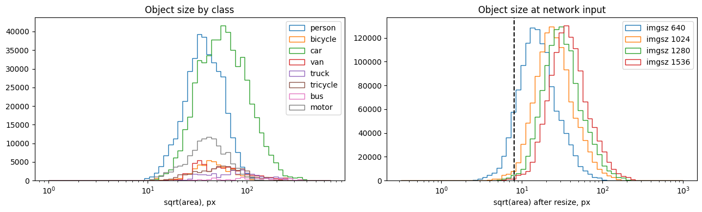
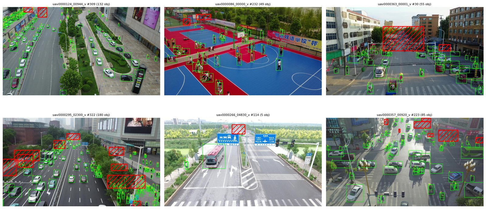
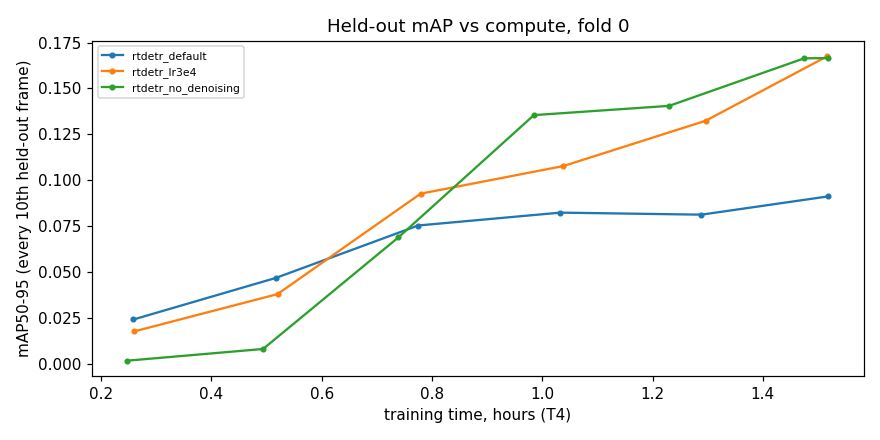
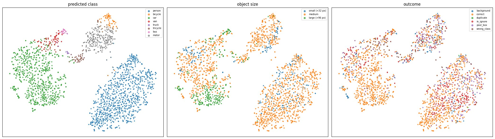

## Introduction

We detect 8 object classes in drone video frames (VisDrone2019-VID) and submit bboxes. The labelled data has 56 train clips and 7 val clips with 1.2 million objects.

We compare four detector families under one protocol and OOF validation, next to a YOLO11s baseline.

## Method

### Data preparation

Code: [01_eda_preprocessing.ipynb](https://github.com/mohinska/ai_hw2_MultipleObjectVideoDetection/blob/main/notebooks/01_eda_preprocessing.ipynb).

The annotations are clean: no zero-size, out-of-frame boxes, duplicates, gaps in numbering.

Findings and decisions:
- At 640 px, 9.7% of objects are below 8 px, at 1280 px only 0.6% do $\rightarrow$ models are trained and evaluated at 1280 px.

- k-means on box sizes gives boxes much smaller than the default anchors $\rightarrow$ test anchors of 16-256 px.

- Dense scenes $\rightarrow$ keep up to 500 detections per image and use 300 queries for RT-DETR.

- Neighbouring frames are near-duplicates $\rightarrow$ train on every 5th frame (five times less compute while the frames still differ).

- 72% of frames have ignored regions or "others". In training we fill them with the frame's mean colour and drop objects at least 50% inside them (all models except the baseline), so crowds are neither learned as background nor counted as misses

- Eight test clips are only 680-960 px wide, and test frames are darker $\rightarrow$ check every inference variant on frames shrunk to 960 px as well.

### Validation

The official val has 7 clips, so we pool train and val and split them into 4 folds with GroupKFold by flight, so no flight is in both train and held-out. Models are compared by out-of-fold mAP of the last epoch. Anchors are fitted on training folds only. Test predictions of the 4 fold models are merged with WBF.

### Protocol and tuning

One protocol for all detectors ([PROTOCOL](https://github.com/mohinska/ai_hw2_MultipleObjectVideoDetection/blob/main/src/core/__init__.py)): COCO weights, 1280 px, every 5th frame, flip, ignored-region masking, 8 epochs, batch 4. Each family changes one parameter at a time on fold 0, and the best experiment gets the full 4-fold CV.

## Results

| Model | Selected | mAP | AP50 | AP75 | AP_small | AP_medium | AP_large | AR500 | ms | Public LB |
|---|---|---:|---:|---:|---:|---:|---:|---:|---:|---:|
| YOLO11s baseline | defaults | 0.188 | 0.356 | 0.173 | 0.053 | 0.175 | 0.334 | 0.291 | 36 | 0.213 |
| Faster R-CNN | step LR | 0.212 | 0.416 | 0.190 | 0.055 | 0.193 | 0.401 | 0.372 | 66 | 0.243 |
| RetinaNet | $\gamma = 0$ | 0.188 | 0.357 | 0.176 | 0.041 | 0.164 | 0.376 | 0.308 | 48 | 0.188 |
| FCOS | default | 0.179 | 0.355 | 0.161 | 0.050 | 0.158 | 0.341 | 0.357 | 49 | 0.162 |
| RT-DETR-L | no denoising (3 folds) | 0.168 | 0.317 | 0.162 | 0.043 | 0.149 | 0.289 | 0.415 | 196 | 0.307 |

### Baseline

YOLO11s, Ultralytics defaults, 20 epochs, no masking ([02](https://github.com/mohinska/ai_hw2_MultipleObjectVideoDetection/blob/main/notebooks/02_baseline.ipynb)). Fold mAP ranges from 0.156 to 0.247 with the held-out flights, more than most experiments differ. On the LB the 4-fold WBF ensemble beats a single fold model (0.213 vs 0.173).

### Two-stage: Faster R-CNN

SGD, lr 0.005, warmup + cosine ([03](https://github.com/mohinska/ai_hw2_MultipleObjectVideoDetection/blob/main/notebooks/03_faster_rcnn.ipynb)). All four experiments are within 0.01 mAP of the default.

The RPN sets the recall ceiling: 1,000 proposals cover 39% of objects under 16 px and 74% of 16-32 px ones. The RoI head keeps most of the covered objects but doesn't tighten tiny boxes. 

Failure cases: distant objects and tightly parked cars get no proposal. Tricycle, motor and bicycle are confused from above; unlabelled parked cars count as fp.

### One-stage anchor-based: RetinaNet

[04](https://github.com/mohinska/ai_hw2_MultipleObjectVideoDetection/blob/main/notebooks/04_retinanet.ipynb). With 32-512 anchors no anchor matches an object under 16 px; anchors 16-256 leave 47% unmatched but double the negatives per positive. They raise AP_small (0.025 $\rightarrow$ 0.042) but lose more on large objects, so mAP falls; lower IoU thresholds are worse. $\gamma = 0$ is best.

Without a proposal stage localisation is weaker and small objects suffer most. Classifier's prior bias handles the imbalance. Better positive assignment addresses this more directly than anchor sizes.

### Anchor-free: FCOS

[05](https://github.com/mohinska/ai_hw2_MultipleObjectVideoDetection/blob/main/notebooks/05_fcos.ipynb). A location is positive for an object if it lies inside the box, within $\text{radius} \times \text{stride}$ of its centre, on the FPN level matching the box size; overlaps go to the smallest box. A wider radius gives more positives, but 4.7% of objects under 16 px get none, being smaller than the stride. In crowds a wider radius makes neighbours' regions overlap.

Search: radius 0.5 / 1.5 / 2.5, box loss $\times 2$. Nothing beats the default: radius 0.5 gives too few positives, 2.5 loses AP_medium in crowds. By size, FCOS is better than RetinaNet only on small objects. Faster R-CNN leads in every bin.

### Query-based: RT-DETR

RT-DETR-L, AdamW, cosine, 300 queries, the baseline's budget of 1.5 GPU-h per fold ([06](https://github.com/mohinska/ai_hw2_MultipleObjectVideoDetection/blob/main/notebooks/06_rtdetr.ipynb)). Hungarian matching assigns each object to exactly one query and trains the rest as "no object", so duplicates are not produced and NMS is not needed. Early in training the matching is unstable, which slows convergence; denoising queries stabilise it.

With the default lr of $10^{-4}$ the model has not converged in 1.5 h; lr $3 \cdot 10^{-4}$ nearly doubles mAP, and without denoising mAP is the same with higher AP_small, so this version is selected. YOLO11s is still higher under this budget, but RT-DETR has the highest recall and is much stronger on frames with more than 100 objects (0.27 vs 0.17 mAP on fold 0). An earlier single RT-DETR-L run scored 0.307 on the public LB, the best single model before the pipeline.

On the same held-out frames and budget, YOLO11s reaches its level after the first epoch, while RT-DETR is still rising at 1.5 h.

### Final pipeline

The pipeline is built on RT-DETR. Every step is chosen on the official val and kept only if it beats the previous one at native resolution, at 960 px and in most clips.

1. Test-time views ([07_pipeline_variants_old](https://github.com/mohinska/ai_hw2_MultipleObjectVideoDetection/blob/main/experiments/07_pipeline_variants_old.ipynb)): flip and $2 \times 2$ tiles merged by NMS raise RT-DETR from 0.264 to 0.287 in 7 of 7 clips.
2. Merging and temporal rescoring ([07_1_temporal_old](https://github.com/mohinska/ai_hw2_MultipleObjectVideoDetection/blob/main/experiments/07_1_temporal_old.ipynb)): WBF over the same views drops to 0.258, since an object seen in one tile gets its score averaged with views that missed it. Temporal rescoring ([rescore](https://github.com/mohinska/ai_hw2_MultipleObjectVideoDetection/blob/main/src/core/temporal.py)) lowers boxes not confirmed in neighbouring frames, but helps in only 3 of 7 clips, so it is not used. LB 0.314.
3. Ensemble ([07_2_ensemble_old](https://github.com/mohinska/ai_hw2_MultipleObjectVideoDetection/blob/main/experiments/07_2_ensemble_old.ipynb)): Faster R-CNN with the same views fused with RT-DETR by WBF; here WBF fits because both models see the same views. Val 0.292, LB 0.322.
4. RT-DETR trained on tiles ([07_1_rtdetr_tiles](https://github.com/mohinska/ai_hw2_MultipleObjectVideoDetection/blob/main/notebooks/07_1_rtdetr_tiles.ipynb)), following SAHI: every training frame is used whole and as $2 \times 2$ tiles cut at full resolution. Its views are chosen by the same rule:

| Variant (val) | Views | mAP | AP_small | mAP @960 | clips better | ms |
|---|---|---:|---:|---:|---:|---:|
| full | full 1280 | 0.255 | 0.105 | 0.246 | - | 121 |
| flip_wbf | + flip | 0.256 | 0.103 | 0.251 | 7/7 | 260 |
| scale_wbf | + 1600 px | 0.260 | 0.106 | 0.254 | 5/7 | 293 |
| tiles_nms | + tiles, NMS | 0.272 | 0.140 | 0.263 | 7/7 | 484 |
| tiles_wbf | + tiles, WBF | 0.254 | 0.142 | 0.250 | 6/7 | 484 |
| all_nms | all, NMS | 0.274 | 0.143 | 0.265 | 7/7 | 795 |
| all_wbf | all, WBF | 0.264 | 0.137 | 0.262 | 6/7 | 795 |

The model trained on tiles is lower on val than the one trained on full frames (0.274 vs 0.287), but it is the best on the public LB (0.329 vs 0.322). Val has 7 clips from a few flights, while test has 48 darker and smaller clips, so val cannot separate differences of 0.01. Training on tiles shows small objects at native size, which should help most on low-resolution test clips, and the LB confirms;

5. Second model on all flights ([07_2_rtdetr_final](https://github.com/mohinska/ai_hw2_MultipleObjectVideoDetection/blob/main/notebooks/07_2_rtdetr_final.ipynb)): the same trained on train + val with another seed and the views of step 4. Since all labelled clips are used, there is no internal score and the LB is the only check. Alone it scores 0.269, well below step 4, but its boxes merged with those of step 4 by class-wise NMS (IoU 0.65) give 0.334, our best submission. The two models make different mistakes, so the merge adds boxes that one of them missed.

Unsuccessful attempts: RetinaNet with smaller anchors or lower IoU thresholds; all FCOS changes; RT-DETR at lr $10^{-4}$; WBF over test-time views; temporal rescoring, which even lowers mAP of the tile-trained model; YOLO11m with the same views; fusion IoU 0.8 in the ensemble; the train + val model alone.

### Bonus: visualization

[08_visualization](https://github.com/mohinska/ai_hw2_MultipleObjectVideoDetection/blob/main/notebooks/08_visualization.ipynb); training curves, configs and held-out predictions of every run are in [W&B](https://wandb.ai/hamaniuk-pn-ucu/visdrone-vid-hw2). Grad-CAM on Faster R-CNN: almost every box is pooled from P2, and small objects are explained only by the stride-4 maps (C4-C5 are close to uniform). t-SNE of RoI features: wrong-class detections gather where the bicycle-motor-tricycle and car-van clusters touch, and detections in ignored regions look like real people and cars.

RT-DETR attention: the decoder samples around the box in the first layers, on the object in the middle ones and on context in the last ones, more for small objects and in dense scenes.

## Final model and reproducibility

Final model: the models of steps 4 and 5 merged by class-wise NMS (IoU 0.65), $\le 500$ boxes per image; public LB 0.334 (step 4 alone: val 0.274, LB 0.329).

Run: notebooks run on Kaggle (GPU T4 $\times 2$, Internet on, competition data attached), clone this repository and install the packages from [requirements.txt](https://github.com/mohinska/ai_hw2_MultipleObjectVideoDetection/blob/main/requirements.txt); seed 42. The final submission: [07_1_rtdetr_tiles](https://github.com/mohinska/ai_hw2_MultipleObjectVideoDetection/blob/main/notebooks/07_1_rtdetr_tiles.ipynb) ($\approx 7$ h), then [07_2_rtdetr_final](https://github.com/mohinska/ai_hw2_MultipleObjectVideoDetection/blob/main/notebooks/07_2_rtdetr_final.ipynb) with its output attached ($\approx 6.5$ h).

## Conclusion

Under one protocol Faster R-CNN is the strongest family, RetinaNet matches the baseline and FCOS is the weakest. RT-DETR does not converge in 1.5 h, yet it is the best single model on the LB and the strongest in dense scenes. Small objects limit every model, and tiles helped more than any architecture or loss change. NMS suits views that see different objects, WBF views of the same objects. Fold scores differ by up to 0.09 between flights, so small differences are not reliable.

AI usage: AI (Claude) helped write and debug code, fix grammar; experiment choices, interpretation and text are ours.

## References

[VisDrone](https://arxiv.org/abs/2001.06303),
[Faster R-CNN](https://arxiv.org/abs/1506.01497),
[FPN](https://arxiv.org/abs/1612.03144),
[RetinaNet](https://arxiv.org/abs/1708.02002),
[YOLOv2](https://arxiv.org/abs/1612.08242),
[FCOS](https://arxiv.org/abs/1904.01355),
[ATSS](https://arxiv.org/abs/1912.02424),
[DETR](https://arxiv.org/abs/2005.12872),
[DN-DETR](https://arxiv.org/abs/2203.01305),
[RT-DETR](https://arxiv.org/abs/2304.08069),
[Ultralytics](https://docs.ultralytics.com),
[GroupKFold](https://scikit-learn.org/stable/modules/generated/sklearn.model_selection.GroupKFold.html),
[COCO metrics](https://cocodataset.org/#detection-eval),
[faster-coco-eval](https://github.com/MiXaiLL76/faster_coco_eval),
[TIDE](https://arxiv.org/abs/2008.08115),
[SAHI](https://arxiv.org/abs/2202.06934),
[WBF](https://arxiv.org/abs/1910.13302),
[Soft-NMS](https://arxiv.org/abs/1704.04503),
[Seq-NMS](https://arxiv.org/abs/1602.08465),
[T-CNN](https://arxiv.org/abs/1604.02532),
[Grad-CAM](https://arxiv.org/abs/1610.02391),
[Deformable DETR](https://arxiv.org/abs/2010.04159),
[t-SNE](https://www.jmlr.org/papers/v9/vandermaaten08a.html)
